# Transaction flow state machine

`useSwapSubmission`, `useSolverRegistration` and `useAcceptIntent` all run on the
shared machine in [`src/lib/flow`](../src/lib/flow):

- [`machine.ts`](../src/lib/flow/machine.ts) — pure `flowReducer` with guarded
  transitions. An illegal event returns the same snapshot (a no-op).
- [`errors.ts`](../src/lib/flow/errors.ts) — shared `classifyFlowError`
  (`network`, `user-rejected`, `balance`, `no-solver`, `validation`, `generic`)
  and i18n keys for guidance (`flow.error.*`).
- [`useTransactionFlow.ts`](../src/lib/flow/useTransactionFlow.ts) — the React
  hook. Flows pass a `run(params, { signal, step })` handler; each
  `step(name, handler)` enters a state and receives the run's `AbortSignal`.

## States

The machine's state union is the authority. Every state below exists in
`machine.ts`; there are no other states.

| State | Meaning |
| --- | --- |
| `idle` | No run in progress. The initial state and the state after `CANCEL`/`RESET`. |
| `pending` | A run is in progress. Carries the current `step` (see below). |
| `success` | The run completed successfully. |
| `error` | The run failed. Carries the classified `error` and the `errorStep` where it failed. |

### Pending steps

While `pending`, the snapshot's `step` is one of:

| Step | Meaning |
| --- | --- |
| `connecting` | Connecting to the wallet / preparing the run. |
| `building` | Building the transaction or request payload. |
| `reviewing` | Reviewing the built transaction before signing. |
| `awaiting_signature` | Waiting for the user to sign in their wallet. |
| `submitting` | Submitting the signed transaction. |

`ADVANCE` only moves forward through these steps; steps may be skipped.

## Transitions

| From | Event | To | Notes |
| --- | --- | --- | --- |
| `idle` | `START` | `pending` | Begins a run. |
| `pending` | `ADVANCE` | `pending` | Moves to the next step (forward only). |
| `pending` | `SUCCEED` | `success` | Run completed. |
| `pending` | `FAIL` | `error` | Records the classified `error` and `errorStep`. |
| `pending` | `CANCEL` | `idle` | Aborts the run. |
| `success` | `START` | `pending` | User starts a new run. |
| `success` | `RESET` | `idle` | Clears the result. |
| `error` | `START` | `pending` | User retry. |
| `error` | `RESET` | `idle` | Clears the error. |

Any event not listed above is a no-op: the reducer returns the same snapshot.

## Statechart

```mermaid
stateDiagram-v2
  [*] --> idle
  idle --> pending: START
  error --> pending: START (user retry)
  success --> pending: START
  state pending {
    connecting --> building
    building --> reviewing
    reviewing --> awaiting_signature
    awaiting_signature --> submitting
    note right of connecting: ADVANCE only moves forward;\nsteps may be skipped
  }
  pending --> success: SUCCEED
  pending --> error: FAIL (records errorStep)
  pending --> idle: CANCEL
  success --> idle: RESET
  error --> idle: RESET
```

## Guarantees

- **Double submit** — `start()` is ignored while a run is pending (guarded by a
  ref, so two clicks in the same tick cannot both start).
- **Cancellation** — `cancel()`, `reset()`, unmount, and a wallet switch or
  disconnect abort the run's `AbortSignal` (forwarded to `apiFetch`) and return
  the machine to `idle`. Cancelled runs never set an error or toast.
- **Late responses** — every event carries a `runId`; results that arrive after
  a cancel, or from a superseded run, are discarded.
- **No silent re-prompts** — nothing is retried automatically. `retry()` only
  re-runs the last failed params when the user asks, so a `user-rejected`
  signature is never replayed without fresh consent.
- **Strict mode** — runs are only created by user actions, so the mount/unmount
  probe of React strict mode cannot abort or duplicate one.

## Price impact

Price impact is how much your trade moves the price against you. A pool's price
shifts as you trade, so larger trades relative to the available liquidity get a
worse rate than the current market price. The quote shows this as a percentage,
and the `RiskBanner` in the swap flow summarises it.

Thresholds, defined in [`src/lib/quoteRisk.ts`](../src/lib/quoteRisk.ts) as
`QUOTE_RISK_THRESHOLDS`:

- **1% or more** — *caution*. Shown for information only.
- **3% or more** — *high price impact*. Check the amounts before you sign.
- **10% or more** — *severe*. You must type `CONFIRM` before you can continue.

To reduce price impact, trade a smaller amount or split the trade into several
smaller ones.
